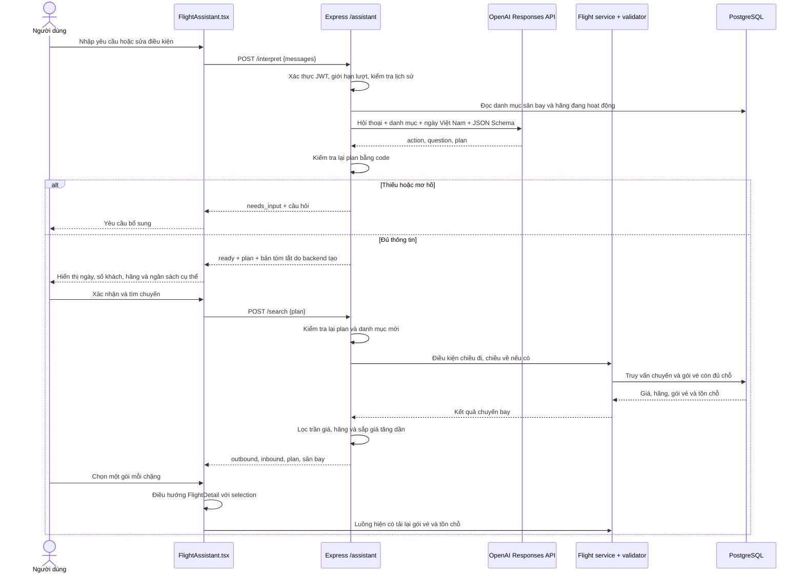

# Trợ lý AI tìm chuyến bay

Tính năng nằm tại **Trang chủ → Tìm vé cùng AI**. Người dùng đăng nhập, nhập yêu cầu bằng tiếng Việt, bổ sung thông tin còn thiếu, xác nhận điều kiện rồi chọn chuyến từ database. Hỗ trợ một chiều, khứ hồi, số người lớn/trẻ em/em bé, hạng ghế, một hãng bay và trần giá vé cơ bản cho mỗi khách mỗi chặng.

## Cấu hình và chạy

### Gemini

Backend tự chọn Gemini khi có `GEMINI_API_KEY`. Có thể đặt `AI_PROVIDER=gemini` hoặc `AI_PROVIDER=openai` để chọn rõ nhà cung cấp.

```dotenv
GEMINI_API_KEY=your_key_here
GEMINI_MODEL=gemini-3-flash-preview
```

Khởi động lại backend sau khi thay đổi `.env`. Gemini gọi REST `generateContent`, truyền hội thoại với role `user`/`model` và dùng JSON Schema giống OpenAI. Lỗi quá tải 503 từ Gemini được thử lại một lần trong tổng thời gian chờ 25 giây; lỗi giới hạn lượt 429 không tự thử lại. Key chỉ dùng ở backend.

### OpenAI

Thêm hai biến trong `be/.env`, giữ nguyên cấu hình database, JWT và Redis đang có:

```dotenv
OPENAI_API_KEY=your_key_here
OPENAI_MODEL=gpt-4.1-mini
```

API key chỉ đặt trên backend. Không đưa vào `fe/.env`, biến `EXPO_PUBLIC_*`, Git hoặc tin nhắn chat. Model cần hỗ trợ Responses API và Structured Outputs; ví dụ cấu hình sử dụng GPT-4.1 mini. Hãy bảo đảm tài khoản API có quyền sử dụng model và hạn mức phù hợp.

Chạy backend trong `be` bằng `npm run dev`, frontend trong `fe` bằng `npm start`. Trên PowerShell có chặn script `npm.ps1`, dùng `npm.cmd` thay cho `npm`. Frontend vẫn dùng `EXPO_PUBLIC_API_URL` và cơ chế JWT sẵn có. Khởi động lại backend sau khi đổi biến môi trường.

Nếu chưa có key/model, endpoint diễn giải báo 503 và giao diện hướng người dùng dùng biểu mẫu tìm vé. Đây là lời gọi API thật, không có chế độ giả lập AI trong sản phẩm. Không cần thay đổi schema hoặc seed lại database.

## Luồng điều khiển



### 1. Giao diện quản lý cuộc trò chuyện

`fe/src/screens/search/FlightAssistant.tsx` giữ `messages`, `input`, `plan`, `results`, chuyến đã chọn và trạng thái đang xử lý trong bộ nhớ của màn hình. Không ghi lịch sử hội thoại vào database, AsyncStorage hay URL. Rời màn hoặc đổi phiên đăng nhập sẽ hủy request và bỏ state cũ; nút làm mới bắt đầu một cuộc mới.

Khi nhấn **Gửi**, frontend gửi toàn bộ lịch sử thành công trước đó cộng tin nhắn mới. Trong lúc xử lý, nút gửi/xác nhận được khóa để tránh gửi trùng. Điều kiện và kết quả cũ bị xóa khi gửi một thay đổi, để không dùng kết quả của yêu cầu trước. Nếu request lỗi, nội dung nhập vẫn còn để thử lại. Nếu mới gõ sửa đổi mà chưa gửi, nút xác nhận/tiếp tục cũng bị khóa.

### 2. Backend chỉ giao việc hiểu câu cho AI

`be/src/routes/assistant.route.ts` xác thực, tải danh mục sân bay/hãng đang hoạt động và lấy ngày hiện tại tại Việt Nam. `assistant.provider.ts` gọi `https://api.openai.com/v1/responses` bằng `fetch` tích hợp của Node. Request dùng `store: false`, timeout 25 giây, tối đa 2.000 output tokens và JSON Schema với `strict: true` theo [OpenAI Docs về Structured Outputs](https://developers.openai.com/api/docs/guides/structured-outputs).

AI nhận nhiệm vụ trích xuất một object có cấu trúc, không có tool truy cập database, tạo booking, hay thanh toán. Kết quả có hai nhánh:

- `clarify`: hỏi thêm ngày, sân bay, ngày về hoặc làm rõ ngân sách/điều kiện chưa hỗ trợ.
- `search`: trả điều kiện để backend kiểm tra; chưa truy vấn chuyến ở bước này.

Các mặc định khi người dùng chưa nhắc tới: một chiều, 1 người lớn, 0 trẻ em/em bé, Phổ thông, mọi hãng, không giới hạn giá. Nơi đi, nơi đến và ngày đi phải được nêu hoặc hỏi bổ sung. Nếu có ngày về, AI được hướng dẫn chuyển sang khứ hồi.

### 3. Code kiểm tra kết quả AI

`assistant.core.ts` kiểm tra mã sân bay/hãng có thật trong danh mục, hai sân bay khác nhau, ngày tồn tại và chưa qua, ngày về không trước ngày đi, hạng ghế, số khách nguyên và tổng từ 1 đến 18, có người lớn và không nhiều em bé hơn người lớn. Ngân sách phải là số nguyên VND dương hoặc `null`.

JSON hợp schema vẫn có thể sai nghiệp vụ nên bước này bắt buộc. Khi AI trả một plan không hợp lệ, backend chuyển thành câu yêu cầu bổ sung. Khi plan hợp lệ, backend tự tạo bản tóm tắt gồm ngày ISO, loại hành trình, số khách, hãng, trần giá; không dùng lời AI để mô tả giá hoặc kết quả bay.

Ngày hiện tại lấy theo `Asia/Ho_Chi_Minh`. “Ngày mai” được AI chuyển thành ngày cụ thể dựa trên ngày này. “Ngày hôm sau” khi sửa điều kiện được hướng dẫn tính từ ngày đang tìm. Các câu mơ hồ như “cuối tuần” phải hỏi ngày cụ thể. Việc hiểu ngôn ngữ vẫn mang tính xác suất, vì vậy người dùng luôn nhìn thấy điều kiện và xác nhận trước khi tìm.

### 4. Tìm chuyến bằng nghiệp vụ hiện có

Khi người dùng xác nhận, `/assistant/search` nhận plan và kiểm tra lại với ngày/danh mục hiện tại. Endpoint này **không gọi AI**. `searchPlan` gọi lại `getFlightsByConditionsService`, giống nghiệp vụ của `/flights/conditions`, không gọi HTTP vòng về chính server.

Một chiều có một truy vấn; khứ hồi chạy hai truy vấn độc lập song song, đảo sân bay và dùng ngày về cho chiều về. Số khách truyền xuống bằng tổng người lớn + trẻ em + em bé, thống nhất với màn tìm vé hiện tại. Database áp dụng quy tắc chuyến/gói đang bán và đủ quota; backend lọc thêm hãng và trần giá cho từng chặng, sắp xếp giá tăng dần.

Không có kết quả là mảng rỗng, được hiển thị thành “Không có chuyến phù hợp”. Database lỗi được báo lỗi qua middleware hiện có, không biến thành không có chuyến. Không có dữ liệu mẫu hoặc giá do AI tạo ra.

### 5. Nối vào luồng chọn vé

Giao diện hiển thị từng gói, gồm hãng, số hiệu chuyến, sân bay, giờ, ngày và giá. Người dùng chọn chiều đi và chiều về nếu có; thiếu một chặng thì không thể tiếp tục. Mỗi lần hiển thị 10 gói, có nút xem thêm.

Nút tiếp tục dùng `navigate("FlightDetail", {flightId, selection})` với cùng hợp đồng của màn tìm chuyến hiện có: `departureFlight`, `returnFlight` và `search` chứa sân bay, ngày, số khách, hạng ghế. Từ đây tiếp tục `FareSelection → PassengerInfo` và các bước đặt vé hiện tại. Màn chi tiết đọc lại gói và tồn chỗ, không dùng giá snapshot làm căn cứ chốt vé. Bộ lọc AI áp dụng ở bước tìm; việc đổi gói sau đó tuân theo giao diện chọn gói hiện có.

## Hợp đồng API

Cả hai endpoint dùng tiền tố `/api/v1/assistant`, yêu cầu `Authorization: Bearer <access_token>` và trả `{status: "success", data: ...}`. Frontend dùng `clientApi` hiện có để tự thêm token, timeout riêng 35 giây.

### POST /interpret

```json
{
  "messages": [
    {"role": "user", "content": "Từ Sài Gòn đi Hà Nội ngày mai, 2 người lớn"}
  ]
}
```

Tin nhắn luân phiên user/assistant, bắt đầu và kết thúc bằng user; tối đa 20 tin, 2.000 ký tự/tin và 16.000 ký tự toàn bộ lịch sử. Frontend cho tối đa 10 lượt rồi yêu cầu làm mới, không tự cắt bỏ ngữ cảnh.

`data` gồm `status: "needs_input" | "ready"`, `message` và `plan` (`null` nếu cần hỏi thêm). Plan đủ điều kiện có dạng:

```json
{
  "departureCode": "SGN",
  "arrivalCode": "HAN",
  "departDate": "2027-01-10",
  "returnDate": "2027-01-12",
  "tripType": "khu-hoi",
  "adults": 2,
  "children": 0,
  "infants": 0,
  "seatClass": "Phổ thông",
  "maxPricePerPerson": 2000000,
  "airlineCode": "VN"
}
```

### POST /search

Body là `{"plan": <plan ở trên>}`. `data` gồm plan chuẩn hóa, hai object sân bay `departure`/`arrival` và hai mảng `outbound`/`inbound` theo kiểu `FlightItem` hiện có. Vé một chiều có `inbound: []`.

| Mã lỗi | Trường hợp |
| --- | --- |
| 400 | Hội thoại hoặc điều kiện gửi vào không hợp lệ |
| 401 | Thiếu JWT hoặc phiên hết hạn |
| 429 | Đang có request khác, vượt giới hạn lượt hoặc OpenAI giới hạn tốc độ |
| 502 | AI từ chối, output thiếu/hỏng hoặc không hoàn tất |
| 503 | Chưa cấu hình key/model, thiếu quyền, hết credit/hạn mức API hoặc dịch vụ AI không khả dụng |
| 504 | Kết nối AI lỗi hoặc hết thời gian chờ |

Lỗi gốc từ OpenAI không được đưa ra giao diện hoặc ghi log chứa prompt/key. Hai endpoint đặt `Cache-Control: no-store`. Giới hạn 30 request/phút/user và một request đang xử lý/user dùng bộ nhớ của mỗi backend instance; nếu triển khai nhiều instance cần chuyển quota sang kho dùng chung như Redis. Có giới hạn kích thước lịch sử và map quota, không lưu vô hạn.

## Phạm vi và giới hạn

- Giá lọc là **giá vé cơ bản VND/khách/chặng**, chưa thuế/phí hay dịch vụ. Không tự quy đổi ngân sách tổng khứ hồi sang ngân sách mỗi chặng. Ngân sách mơ hồ cần hỏi lại.
- Số người lớn/trẻ em/em bé được giữ để chuyển tới luồng đặt vé. Kết quả tìm không tính giảm giá theo tuổi; cách kiểm tra quota giữ đúng hành vi hiện có của app.
- Tìm ngày cụ thể, tối đa hai chặng khứ hồi và một hãng. Yêu cầu về giờ bay, hành lý, điểm dừng, ngày linh hoạt hoặc nhiều thành phố được hướng dẫn hỏi lại trước khi bỏ điều kiện.
- Hội thoại là dữ liệu do client cung cấp, không phải bằng chứng xác nhận đặt vé hay quyền thao tác. Server không lưu phiên AI; lịch sử được gửi lại để hiểu các câu tiếp theo.
- Không giữ chỗ, tạo booking hay thanh toán ở các endpoint trợ lý. Lựa chọn vẫn cần được kiểm tra lại bởi luồng đặt vé hiện tại.

## Kiểm tra

```powershell
# Trong be
npm.cmd run build
node --import tsx --test tests/assistant.test.ts tests/flight.validator.test.ts

# Trong fe
npm.cmd run typecheck
npm.cmd run lint
npm.cmd run test:navigation
```

Kiểm thử AI dùng `fetch` giả lập: kiểm tra JSON Schema, toàn bộ ngữ cảnh, timeout/lỗi/từ chối và không gọi API trả phí. Core được kiểm tra ngày, sân bay, số khách, ngân sách, đảo chặng khứ hồi, lọc giá/hãng, dữ liệu rỗng và lỗi database. Cần key/model thật, database có chuyến phù hợp và thiết bị để kiểm tra đầu cuối.

Kịch bản thử thủ công:

1. Đăng nhập → Trang chủ → Tìm vé cùng AI.
2. Nhập “Tìm vé từ Sài Gòn đi Hà Nội” → bổ sung ngày khi được hỏi.
3. Nhập “Đổi sang ngày hôm sau” → kiểm tra ngày ISO trong tóm tắt tăng một ngày.
4. Nhập “Khứ hồi, về ngày …” → kiểm tra chiều về và thứ tự ngày.
5. Nhập “Chỉ Vietnam Airlines, tối đa 2 triệu mỗi khách mỗi chặng” → xác nhận và kiểm tra bộ lọc.
6. Chọn đủ chặng → xem chi tiết → kiểm tra số khách, ngày và gói vé được giữ.
7. Thử “cuối tuần” hoặc “tổng ngân sách 4 triệu” → kiểm tra câu hỏi làm rõ.
8. Thử mất kết nối, không có chuyến hoặc chưa cấu hình key → kiểm tra lỗi và khả năng thử lại.
9. Làm mới cuộc trò chuyện hoặc đăng xuất → kiểm tra lịch sử/kết quả cũ không xuất hiện trong phiên mới.

Tham khảo: [OpenAI Docs — Structured Outputs](https://developers.openai.com/api/docs/guides/structured-outputs), [GPT-4.1 mini](https://developers.openai.com/api/docs/models/gpt-4.1-mini), [Expo Router](https://docs.expo.dev/router/introduction/).
