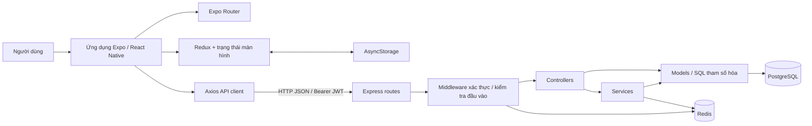
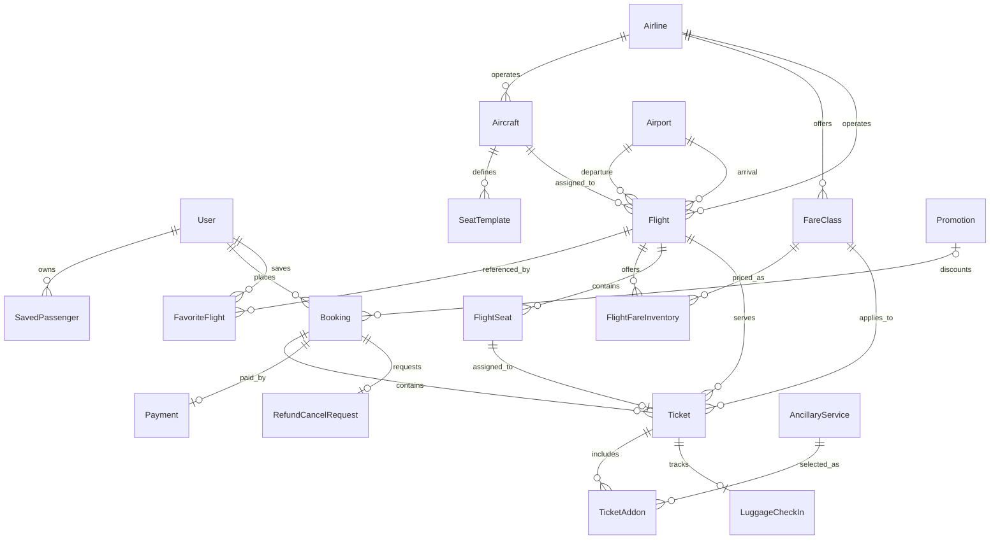
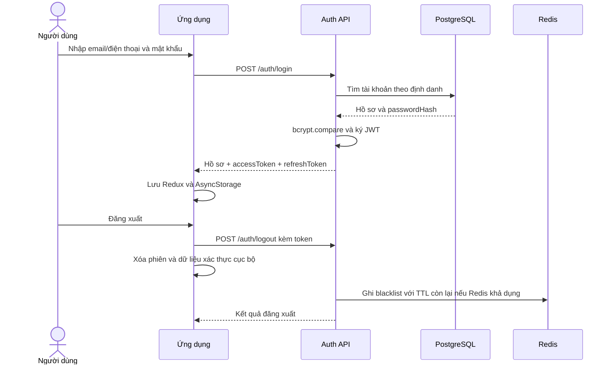
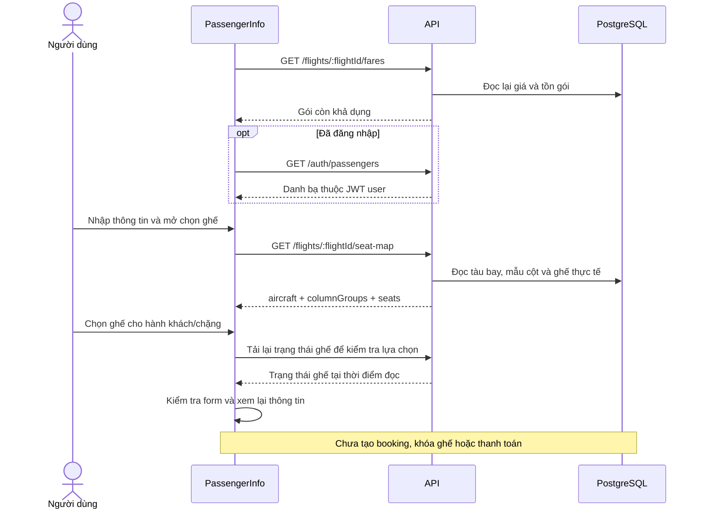
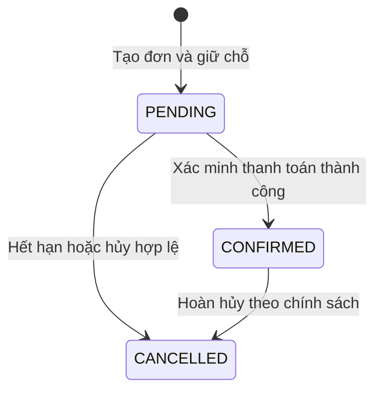
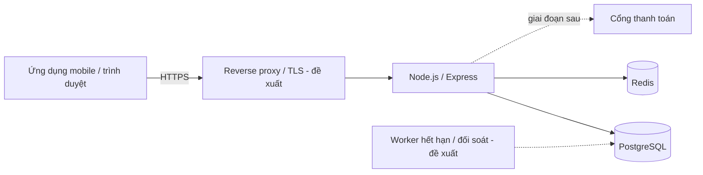

# Tài liệu thiết kế phần mềm (SDS)

**Hệ thống:** SkyJourney – Ứng dụng đặt vé máy bay  
**Mã tài liệu:** SDS-SKYJOURNEY  
**Phiên bản:** 1.0  
**Ngày lập:** 29/10/2026  
**Cơ sở thiết kế:** mã nguồn trong repository BookingFlight_App tại thời điểm lập tài liệu  
**Trạng thái:** Bản thiết kế để rà soát; chưa có xác nhận nghiệm thu

## 1. Mục đích và phạm vi

Tài liệu mô tả kiến trúc, thành phần, dữ liệu, giao diện tích hợp và luồng xử lý của SkyJourney. Đối tượng sử dụng gồm nhóm phát triển, kiểm thử, vận hành và người đánh giá dự án.

SDS được xây dựng từ mã nguồn hiện có, không phải báo cáo xác nhận hệ thống đã vận hành thực tế. Các nội dung dùng ba nhãn:

- **Hiện có:** có mã xử lý hoặc tích hợp tương ứng trong repository.
- **Giao diện mẫu:** có màn hình nhưng dữ liệu hoặc xử lý nghiệp vụ chưa kết nối đầy đủ.
- **Đề xuất:** thiết kế bổ sung cho giai đoạn tiếp theo, chưa được triển khai.

Phạm vi hiện có gồm tài khoản, sân bay, tìm chuyến bay, lịch giá, gói vé, danh bạ hành khách, xem và chọn ghế trong phiên, thao tác yêu thích tại chi tiết chuyến bay. Tạo đơn đặt chỗ, giữ ghế, thu tiền, phát hành vé và check-in trực tuyến chưa tạo thành luồng nghiệp vụ hoàn chỉnh.

### 1.1. Thuật ngữ

| Thuật ngữ | Ý nghĩa trong tài liệu |
| --- | --- |
| Booking | Đơn đặt chỗ tổng, có thể chứa nhiều vé và hai chiều bay |
| Ticket | Vé của một hành khách trên một chuyến bay |
| FareClass | Gói vé và điều kiện hành lý, hoàn đổi của hãng |
| FlightFareInventory | Giá và hạn mức mở bán của một gói trên một chuyến |
| FlightSeat | Ghế thực tế và trạng thái khả dụng trên chuyến bay |
| PNR | Mã đặt chỗ; schema dự kiến chuỗi sáu ký tự, chưa có bộ sinh nghiệp vụ |
| JWT | Token dùng xác thực yêu cầu API |
| API | Giao diện HTTP giữa ứng dụng và backend |

### 1.2. Ma trận phạm vi

| Mã | Chức năng | Trạng thái thiết kế/triển khai |
| --- | --- | --- |
| F01 | Đăng ký, đăng nhập, đăng xuất | Hiện có; thu hồi token phụ thuộc Redis |
| F02 | Xem/sửa hồ sơ, đổi mật khẩu | Hiện có |
| F03 | Tra cứu sân bay | Hiện có |
| F04 | Tìm chuyến một chiều, lựa chọn hành trình khứ hồi | Hiện có; API tìm từng chiều |
| F05 | Lịch giá và lựa chọn gói vé | Hiện có |
| F06 | Nhập hành khách/liên hệ, lấy danh bạ đã lưu | Hiện có; bản nháp nằm tại frontend |
| F07 | Xem sơ đồ, chọn ghế từng chặng | Hiện có; chưa giữ ghế trên server |
| F08 | Lưu/bỏ lưu chuyến yêu thích | API hiện có; tab danh sách còn dữ liệu mẫu |
| F09 | Danh sách vé, chi tiết vé, thông báo | Giao diện mẫu; thông báo cập nhật trong phiên |
| F10 | Check-in trực tuyến | Giao diện mẫu |
| F11 | Booking, thanh toán, phát hành vé, hoàn hủy | Có mô hình dữ liệu; nghiệp vụ và API cần bổ sung |
| F12 | Khuyến mãi, dịch vụ mua thêm, đánh giá, cảnh báo giá | Có mô hình dữ liệu; chưa có luồng tích hợp đầy đủ |

## 2. Kiến trúc tổng thể

Hệ thống hiện dùng kiến trúc ứng dụng khách và backend tập trung. Backend tổ chức theo các lớp route, controller, service, model; PostgreSQL lưu dữ liệu lâu dài. Redis hỗ trợ hạ tầng cache và danh sách token thu hồi. Không có bằng chứng triển khai microservice hoặc tích hợp trực tiếp hệ thống đặt chỗ của hãng hàng không.



Một số controller như `bookingOptions.controller.ts` gọi trực tiếp model. Đây là cấu trúc hiện có; sơ đồ không giả định mọi yêu cầu đều đi qua service. Hạ tầng cache có cơ chế đọc database khi Redis lỗi, nhưng truy vấn tìm chuyến hiện đọc PostgreSQL trực tiếp.

### 2.1. Công nghệ

Các phiên bản dưới đây là khai báo trong `package.json`, không phải kết quả kiểm tra môi trường đã cài đặt.

| Lớp | Công nghệ |
| --- | --- |
| Ứng dụng | Expo SDK 57, React 19.2, React Native 0.86, TypeScript |
| Giao diện/điều hướng | Expo Router, NativeWind 4, Tailwind CSS 3, Reanimated |
| Trạng thái/lưu cục bộ | Redux Toolkit, React Redux, AsyncStorage |
| HTTP client | Axios; timeout cấu hình 10 giây |
| API server | Node.js, Express 5, TypeScript |
| Dữ liệu | PostgreSQL, `pg`; Prisma 6 quản lý schema/client và seed |
| Xác thực | `jsonwebtoken`, `bcryptjs` |
| Cache | Redis; Docker Compose hiện chỉ khai báo Redis |

## 3. Thiết kế các thành phần

### 3.1. Frontend

| Thành phần | Trách nhiệm | Vị trí |
| --- | --- | --- |
| Route/layout | Định tuyến, tổ chức tab/stack, kiểm soát truy cập màn hình theo đăng nhập | `fe/src/app`, `fe/src/navigation` |
| Screens | Hiển thị và điều phối luồng tìm chuyến, gói vé, hành khách, tài khoản | `fe/src/screens` |
| Components | Header, modal, thẻ gói vé, biểu mẫu và sơ đồ ghế dùng chung | `fe/src/components` |
| API client | Xác định base URL, gắn Bearer token, nhận lỗi HTTP | `fe/src/api` |
| Redux | Trạng thái xác thực, hồ sơ và thông báo | `fe/src/store` |
| Hooks/utilities | Điều phối chọn gói, yêu thích; kiểm tra form, ghế và dữ liệu điều hướng | `fe/src/hook`, `fe/src/utils` |

`authSlice` lưu người dùng, access token, refresh token, trạng thái khởi tạo, đang tải và lỗi. Khi mở ứng dụng, `initAuth` phục hồi dữ liệu từ AsyncStorage; việc phục hồi này chưa tự xác nhận token còn hiệu lực trên server. Đăng xuất xóa trạng thái cục bộ và thông tin xác thực đã lưu.

API client ưu tiên `EXPO_PUBLIC_API_URL`, sau đó suy ra host Expo hoặc dùng địa chỉ dự phòng theo nền tảng. Client tự thêm `/api/v1`. Interceptor gắn token hiện hành vào yêu cầu; khi nhận 401 phù hợp với token đang dùng, client xóa phiên. Backend trả 403 cho token sai/hết hạn nên nhánh dọn phiên 401 chưa bao phủ toàn bộ tình huống này.

Thông tin hành khách và liên hệ nằm trong state biểu mẫu. Tham số chuyển tới `PassengerInfo` gồm ID chuyến, ID gói và cơ cấu khách; không chứa bản nháp dữ liệu cá nhân. Người dùng cần nhập lại dữ liệu nếu state màn hình bị mất.

### 3.2. Backend

| Thành phần | Trách nhiệm |
| --- | --- |
| `server.ts` | Nạp cấu hình, tạo Express, bật CORS/JSON, gắn routes và xử lý lỗi, khởi tạo Redis nền |
| `routes` | Ánh xạ URL và phương thức HTTP; gắn middleware xác thực cho tài nguyên riêng |
| `controllers` | Đọc request, gọi xử lý tương ứng, trả HTTP response |
| `services` | Nghiệp vụ tài khoản; điều phối kiểm tra đầu vào tìm chuyến và gói vé |
| `validators`, `middlewares` | Kiểm tra dữ liệu tìm kiếm, đăng ký/đăng nhập và xác thực JWT |
| `models` | Truy vấn PostgreSQL bằng `pg` và tham số SQL |
| `utils/seatLayout.ts` | Xử lý cấu trúc cột ghế và bố cục khoang |
| `redis/redisCache.ts` | Các thao tác cache và blacklist token, bỏ qua Redis khi không sẵn sàng |
| `middlewares/errorrHandler.ts` | Chuyển lỗi thành JSON; chỉ trả stack ở development |

### 3.3. Quy tắc phụ thuộc

Frontend truy cập dữ liệu qua API. Quyền truy cập danh bạ hành khách và yêu thích lấy `userId` từ JWT, không lấy chủ sở hữu từ body/query. Schema Prisma là nguồn mô tả cấu trúc dữ liệu; logic truy vấn nghiệp vụ chủ yếu nằm ở model SQL, vì vậy thay đổi schema phải đối chiếu cả hai nơi.

## 4. Thiết kế dữ liệu

### 4.1. Từ điển thực thể

Schema hiện có **25 model**. UUID là định danh chính phổ biến; các bảng nghiệp vụ dùng nhiều cờ `isActive` để biểu thị bản ghi đang sử dụng. Sự tồn tại của bảng không đồng nghĩa chức năng tương ứng đã có API.

| Thực thể | Thuộc tính chính / ý nghĩa |
| --- | --- |
| User | Email, phone duy nhất; passwordHash; hồ sơ, vai trò, điểm và hạng thành viên |
| SavedPassenger | Chủ sở hữu, tên, loại khách, ngày sinh, giấy tờ |
| Airport | Mã sân bay duy nhất, tên, thành phố, quốc gia |
| Airline | Mã hãng duy nhất, tên, logo |
| Aircraft | Hãng, đăng bạ duy nhất, dòng tàu bay, tổng ghế, bố cục ghế |
| SeatTemplate | Mẫu ghế theo tàu bay, số ghế, hàng/cột, hạng và loại ghế |
| FareClass | Gói vé thuộc hãng; hành lý, được hoàn hay không, phí đổi |
| Flight | Hãng, tàu bay, sân bay đi/đến, giờ bay, giá cơ bản, trạng thái |
| FlightFareInventory | Chuyến, gói, giá, totalQuota, soldCount |
| FlightSeat | Chuyến, số ghế, hạng/loại, phụ phí, isBooked, lockedUntil |
| Promotion | Mã, loại và mức giảm, thời hạn, hạn mức sử dụng |
| UserCoupon | Mã khuyến mãi đã nhận theo người dùng và trạng thái sử dụng |
| Booking | PNR, người đặt, thông tin liên hệ, tổng tiền, khuyến mãi, trạng thái |
| Ticket | Booking, chuyến, ghế, gói, hành khách, giá, chiều bay, QR và trạng thái |
| AncillaryService | Dịch vụ theo hãng: hành lý, suất ăn, bảo hiểm, phòng chờ |
| TicketAddon | Dịch vụ gắn với vé, số lượng và giá tại lúc đặt |
| LuggageCheckIn | Vé, mã thẻ hành lý duy nhất, khối lượng và trạng thái |
| Payment | Booking duy nhất, phương thức, mã giao dịch, số tiền, trạng thái |
| RefundCancelRequest | Booking duy nhất, lý do, phí phạt, số tiền hoàn, trạng thái |
| Notification | Người nhận, tiêu đề/nội dung, trạng thái đọc |
| FavoriteFlight | Người dùng và chuyến bay được lưu |
| FlightReview | Người dùng, chuyến, hãng, điểm đánh giá và nhận xét |
| PriceAlert | Người dùng, sân bay đi/đến, ngưỡng giá |
| Destination | Thành phố, quốc gia, ảnh, mô tả và cờ nổi bật |
| TaxAndFee | Hãng tùy chọn, phí quản trị/sân bay/an ninh/nhiên liệu, VAT, tiền tệ |

### 4.2. Sơ đồ quan hệ chính

Sơ đồ rút gọn thể hiện lõi tài khoản, tồn chỗ và đặt vé; các bảng bổ sung được liệt kê ở từ điển thực thể.



### 4.3. Ràng buộc và chỉ mục hiện có

| Đối tượng | Ràng buộc / chỉ mục | Mục đích |
| --- | --- | --- |
| User | Unique email, phone | Tránh trùng định danh đăng nhập |
| SeatTemplate | Unique `(aircraftId, seatNumber)` | Mỗi vị trí mẫu xuất hiện một lần trên tàu bay |
| Flight | Index `(departureAirportId, arrivalAirportId, departureTime)` | Hỗ trợ tìm tuyến theo ngày |
| FlightFareInventory | Unique `(flightId, fareClassId)` | Một mức tồn cho một gói/chuyến |
| FlightSeat | Unique `(flightId, seatNumber)` | Không trùng vị trí trên cùng chuyến |
| FavoriteFlight | Unique `(userId, flightId)` | Lưu yêu thích lặp lại không tạo bản sao |
| UserCoupon | Unique `(userId, promotionId)` | Mỗi tài khoản nhận một bản ghi cho mỗi khuyến mãi |
| Booking | Unique pnrCode, userCouponId; index `(userId, createdAt)` | Định danh đơn, liên kết coupon và tra lịch sử |
| Ticket | Unique ticketNumber, flightSeatId; index bookingId và `(flightId, fareClassId)` | Định danh vé, quan hệ ghế và tra cứu |
| Payment / RefundCancelRequest | Unique bookingId | Mô hình hiện tại tối đa một bản ghi mỗi loại trên một đơn |
| Notification | Index `(userId, isRead, createdAt)` | Hỗ trợ truy vấn thông báo người dùng |

Giá vé và các tổng tiền chủ yếu dùng `Int`, quy ước VND trong luồng hiện có. Các cột phí và `vat_percent` trong `TaxAndFee` dùng `BigInt?`; nếu bổ sung API trả các giá trị này cần quy định chuyển sang chuỗi hoặc kiểu JSON an toàn. Chưa có công thức thuế tổng hợp được tích hợp vào luồng đặt vé.

`Ticket.flightSeatId` bắt buộc và duy nhất đặt ra hai điểm cần xử lý khi hoàn thiện nghiệp vụ: trẻ sơ sinh không có ghế riêng và việc bán lại ghế khi vé cũ đã hủy. Schema cũng chỉ có một `Payment` cho mỗi booking, chưa mô hình hóa nhiều lần thử thanh toán.

## 5. Thiết kế giao diện API

### 5.1. Quy ước

- Prefix nghiệp vụ: `/api/v1`; request/response dùng JSON.
- Tài nguyên riêng yêu cầu `Authorization: Bearer <accessToken>`.
- Các API chuyến bay thường trả `{ "status": "success", "data": ... }`, một số kèm `message`.
- API tài khoản có response dạng `success: true`; đăng nhập trả `data` và `token` ở cấp ngoài. Chưa có một envelope thống nhất cho toàn hệ thống.
- Lỗi có `status` và `message`; development có thêm thông tin lỗi và stack.

### 5.2. Danh mục endpoint hiện có

| Method | Đường dẫn sau prefix | Xác thực | Thiết kế xử lý |
| --- | --- | --- | --- |
| POST | `/auth/register` | Không | Kiểm tra đầu vào/trùng email, phone; hash mật khẩu; tạo tài khoản |
| POST | `/auth/login` | Không | Nhận identifierValue/password; trả hồ sơ và hai token |
| POST | `/auth/logout` | Không bắt buộc middleware | Đưa token được gửi kèm vào blacklist khi có thể |
| GET | `/auth/profile` | Có | Hồ sơ của JWT user |
| PUT | `/auth/profile` | Có | Cập nhật hồ sơ người đang đăng nhập |
| PUT | `/auth/change-password` | Có | Kiểm tra mật khẩu cũ, kiểm tra và hash mật khẩu mới |
| GET | `/auth/passengers` | Có | Danh bạ hành khách đang hoạt động của JWT user |
| GET | `/airports` | Không | Danh sách sân bay đang hoạt động |
| POST | `/flights/conditions` | Không | Tìm chuyến/gói theo điều kiện |
| POST | `/flights/calendar` | Không | Giá thấp nhất và số chuyến theo từng ngày |
| GET | `/flights/:flightId/fares?passengers=1` | Không | Các gói đủ chỗ của chuyến, gồm cả hai hạng |
| GET | `/flights/:flightId/seats` | Không | Mảng ghế thực tế và trạng thái khả dụng |
| GET | `/flights/:flightId/seat-map` | Không | Thông tin tàu bay, nhóm cột và mảng ghế |
| GET / PUT / DELETE | `/flights/:flightId/favorite` | Có | Đọc/lưu/bỏ yêu thích của JWT user |

`GET /health` nằm ngoài prefix và trả trạng thái tiến trình; không xác nhận PostgreSQL hoặc Redis hoạt động. Chưa có endpoint refresh token, tạo booking, thanh toán, phát hành vé hay check-in.

### 5.3. Hợp đồng tìm kiếm và lịch giá

Ví dụ request `POST /api/v1/flights/conditions`:

```json
{
  "departureCode": "SGN",
  "arrivalCode": "HAN",
  "departDate": "2026-11-18",
  "passengers": 2,
  "seatClass": "Phổ thông"
}
```

Mã sân bay được trim, chuyển hoa và kiểm tra ba chữ cái; điểm đi phải khác điểm đến. Ngày phải hợp lệ theo `YYYY-MM-DD`; số khách là số nguyên 1–18. Hạng nhận `Phổ thông` hoặc `Thương gia`. Lịch giá thay `departDate` bằng `startDate`, `endDate`, tối đa 31 ngày tính cả hai đầu.

Kết quả tìm kiếm gồm `flightId`, `flightNumber`, `durationMinutes`, `airline`, `aircraft`, `departure`, `arrival`, `ticket`. `ticket` chứa `fareClassId`, tên gói, giá, chỗ còn lại, hành lý, quyền hoàn và phí đổi. Một chuyến có thể xuất hiện dưới nhiều gói vé; mỗi lựa chọn cần nhận diện bằng cả ID chuyến và ID gói.

Ví dụ response lịch giá minh họa:

```json
{
  "status": "success",
  "message": "Flight calendar fetched successfully",
  "data": [
    { "date": "2026-11-18", "minPrice": 990000, "flightCount": 3 },
    { "date": "2026-11-19", "minPrice": null, "flightCount": 0 }
  ]
}
```

Ngày không có chuyến hợp lệ vẫn có phần tử với giá `null`. Các con số trên chỉ minh họa hợp đồng, không phải kết quả kiểm thử database.

### 5.4. Quy tắc trả lỗi

| HTTP | Trường hợp hiện có tiêu biểu |
| --- | --- |
| 400 | Điều kiện tìm kiếm, UUID hoặc số khách không hợp lệ; đăng ký trùng định danh |
| 401 | Thiếu token, token bị blacklist hoặc sai mật khẩu đăng nhập |
| 403 | Token sai chữ ký hoặc hết hạn theo middleware hiện tại |
| 404 | Không có tài khoản/hồ sơ; chuyến không còn mở chọn ghế tại endpoint seat-map |
| 500 | Lỗi máy chủ hoặc dữ liệu; không chuyển lỗi truy vấn tìm kiếm thành kết quả rỗng thành công |

## 6. Thiết kế luồng nghiệp vụ hiện có

### 6.1. Đăng nhập và đăng xuất



Đăng ký hash mật khẩu với bcrypt cost 10. Hai token đăng nhập hiện cùng thời hạn 7 ngày và chứa `userId`, `role`. Có phát hành refresh token nhưng chưa có API đổi refresh token lấy access token mới.

Middleware kiểm tra blacklist rồi xác minh JWT. Khi Redis lỗi hoặc không sẵn sàng, thao tác blacklist có thể bị bỏ qua; token còn hạn đã sao chép có thể tiếp tục được chấp nhận. Đổi mật khẩu hiện chưa thu hồi toàn bộ token đã phát hành.

### 6.2. Tìm chuyến và chọn gói

1. Người dùng nhập sân bay, ngày, số khách và hạng ghế; khứ hồi có thêm ngày về.
2. Frontend gọi API tìm kiếm/lịch giá cho chiều tương ứng.
3. Backend kiểm tra đầu vào và truy vấn các thực thể đang hoạt động, chuyến có trạng thái `SCHEDULED`.
4. Điều kiện tồn gói là `totalQuota - soldCount >= passengers`. Hạng tìm kiếm hiện được suy ra bằng mẫu tên gói: Economy/Eco, Deluxe, Phổ thông hoặc Business/Thương gia.
5. Kết quả tìm kiếm sắp theo giá, giờ khởi hành và ID gói. Lịch giá dùng cùng điều kiện và đếm số chuyến phân biệt.
6. Màn chọn gói tải lại các gói của đúng chuyến. Người dùng chọn gói cho mỗi chặng.
7. Màn hành khách tải lại ID gói đã chọn; chặn tiếp tục nếu lựa chọn không còn hợp lệ.

Giá tìm kiếm là giá một khách của gói. API chưa tính đầy đủ thuế, giảm giá trẻ sơ sinh và dịch vụ mua thêm. Chọn gói chưa trừ tồn hoặc đặt giữ chỗ. Quy tắc ngày hiện dựa trên phép so sánh ngày trong PostgreSQL; cần chốt quy ước múi giờ trước khi mở rộng hành trình quốc tế.

### 6.3. Nhập hành khách và chọn ghế



Quy tắc form hiện có:

- Tạo đúng số biểu mẫu theo người lớn, trẻ em, trẻ sơ sinh; không tự thêm khách mẫu.
- Họ tên hợp lệ, ngày sinh có thật theo `DD/MM/YYYY`, không sau ngày bay; form mới yêu cầu họ, tên, giới tính và quốc tịch.
- Tuổi tính tại ngày bay: người lớn từ 12 tuổi, trẻ em từ 2 đến dưới 12, trẻ sơ sinh dưới 2.
- Form người lớn kiểm tra giấy tờ tối thiểu sáu ký tự; đây là kiểm tra giao diện, chưa xác thực giấy tờ thực tế.
- Thông tin liên hệ kiểm tra tên, định dạng email và số điện thoại.
- Ghế đã đặt hoặc có `lockedUntil > NOW()` không khả dụng. Không có dữ liệu ghế thì hiển thị trạng thái thiếu sơ đồ; không sinh ghế giả từ API.
- Kiểm tra ghế tại frontend không bảo đảm chống đặt trùng giữa nhiều người dùng; bảo đảm đó cần giao dịch giữ chỗ ở backend.

### 6.4. Yêu thích

GET đọc trạng thái yêu thích của JWT user. PUT thêm bằng `ON CONFLICT DO NOTHING` nên gọi lặp không tạo bản ghi trùng. DELETE xóa theo cặp user/chuyến. Response trả `{ favorite: boolean }` phản ánh trạng thái sau xử lý; tab danh sách yêu thích chưa có API danh sách tương ứng được tích hợp.

## 7. Thiết kế đề xuất cho luồng đặt vé hoàn chỉnh

Toàn bộ mục này là **đề xuất**, không phải mô tả endpoint hoặc cơ chế đang hoạt động.

### 7.1. Ranh giới dịch vụ và hợp đồng dự kiến

| Endpoint đề xuất | Trách nhiệm |
| --- | --- |
| `POST /bookings` | Xác thực người đặt, tính lại giá, giữ tồn/ghế, tạo đơn chờ thanh toán |
| `GET /bookings`, `GET /bookings/:id` | Trả lịch sử/chi tiết của người sở hữu |
| `POST /bookings/:id/payments` | Tạo yêu cầu thanh toán cho đơn còn hiệu lực |
| `POST /payments/webhook` | Xác minh sự kiện từ cổng thanh toán, đối soát và xử lý một lần |
| `POST /bookings/:id/cancel` | Kiểm tra điều kiện hủy, giải phóng chỗ hoặc lập yêu cầu hoàn |
| `POST /tickets/:id/check-in` | Kiểm tra chủ vé, thời gian, trạng thái và thông tin bắt buộc |

Đầu vào tạo booking nên chứa ID chuyến/gói/ghế, hành khách, liên hệ và mã khuyến mãi nếu có. Server phải tự đọc lại giá và điều kiện, không sử dụng số tiền frontend như nguồn tin cậy. Mọi endpoint chi tiết phải kiểm tra quyền sở hữu.

### 7.2. Giao dịch giữ chỗ và chống trùng

1. Nhận khóa idempotency để lần gửi lại không tạo thêm đơn.
2. Bắt đầu transaction trên cùng kết nối PostgreSQL; khóa các bản ghi tồn và ghế theo thứ tự ổn định.
3. Kiểm tra trạng thái chuyến, gói, giá, quota và ghế. Tính cả lượng đang giữ chưa hết hạn khi xác định tồn có thể bán.
4. Gắn quyền sở hữu giữ chỗ với booking và thời điểm hết hạn; thiết kế thời gian giữ dự kiến 10 phút, cần được chốt theo nghiệp vụ.
5. Tạo booking `PENDING`, lưu bảng phân rã giá và dữ liệu hành khách cần thiết; commit rồi mới gọi cổng thanh toán.
6. Worker hết hạn giải phóng giữ chỗ bằng thao tác có điều kiện; callback thanh toán và worker phải dùng chung quy tắc khóa để tránh tranh chấp.

Schema cần bổ sung quan hệ chủ sở hữu giữ ghế, thời hạn đơn, cơ chế giữ tồn gói và nơi lưu hành khách đang chờ thanh toán. Chỉ có `FlightSeat.lockedUntil` không đủ xác định ai sở hữu khóa. Cần thiết kế lại liên kết vé–ghế nếu cho phép trẻ sơ sinh không có ghế hoặc tái bán ghế sau hủy vé.

### 7.3. Thanh toán và trạng thái



Sơ đồ là vòng đời dự kiến của `Booking`. Thanh toán thất bại có thể cho phép thử lại khi đơn còn hiệu lực; không tự coi một lần thất bại là hủy đơn. Tiền đã thu sau khi đơn hết hạn cần đưa vào luồng đối soát/hoàn tiền, không tự xác nhận ghế đã bán cho đơn khác.

Webhook phải kiểm tra chữ ký, mã giao dịch, số tiền, tiền tệ và trạng thái đơn. Lưu sự kiện để chống xử lý trùng; chỉ sau khi xác minh mới chuyển trạng thái, cập nhật tồn và phát hành vé. Mô hình nhiều lần thử thanh toán cần bảng giao dịch hoặc thay đổi quan hệ `Payment.bookingId` hiện đang duy nhất.

Giá dự kiến: `totalAmount = subTotal + taxAndFees - discountAmount`. Cần chốt cách tính theo tuổi, hãng, thuế, làm tròn và dịch vụ; lưu giá tại lúc đặt để lịch sử không đổi khi danh mục cập nhật.

## 8. Thiết kế bảo mật và yêu cầu chất lượng

### 8.1. Hiện trạng và việc cần hoàn thiện

| Nội dung | Hiện có | Thiết kế cần bổ sung |
| --- | --- | --- |
| Mật khẩu | bcrypt cost 10; đổi mật khẩu kiểm tra mật khẩu cũ, tối thiểu sáu ký tự và không trùng cũ | Chính sách mật khẩu thống nhất, hạn chế thử đăng nhập |
| JWT | Bearer, chữ ký, hạn token, blacklist Redis | Bỏ secret dự phòng, kiểm tra cấu hình bắt buộc, refresh/rotation và thu hồi phiên |
| Lưu token | Redux và AsyncStorage | Kho bảo mật của nền tảng khi triển khai mobile thực tế |
| Quyền dữ liệu | Danh bạ/yêu thích lấy chủ sở hữu từ JWT | Chính sách quyền cho booking, vé, quản trị; vai trò ADMIN trong schema chưa đủ tạo phân quyền |
| Truy vấn | SQL tham số hóa trong các luồng đã khảo sát | Duy trì tham số hóa và transaction cho luồng ghi mới |
| Truyền dữ liệu | URL API cấu hình được; PostgreSQL bật SSL | HTTPS, giới hạn origin; xác minh chứng thư DB thay `rejectUnauthorized: false` |
| Xử lý lỗi | Handler tập trung, ẩn stack ở production | Thống nhất response và mã 401/403 giữa hai phía |
| Dữ liệu cá nhân | Bản nháp hành khách không đưa vào URL | Chính sách lưu giữ/xóa, che thông tin log, kiểm soát truy cập vận hành |

`server.ts` hiện gọi `cors()` không giới hạn origin. Đăng nhập có secret dự phòng trong mã. Đây là các khoảng trống thiết kế cần xử lý trước triển khai công khai, không phải tính năng bảo mật đã hoàn thành.

### 8.2. Tiêu chí chất lượng đề xuất

Chưa có số liệu benchmark, SLA hay tải mục tiêu được xác nhận. Các tiêu chí dưới đây là cơ sở lập kế hoạch kiểm thử và cần được nhóm dự án chốt:

- **Đúng đắn:** tìm kiếm và lịch giá thống nhất bộ lọc; không trả dữ liệu mẫu khi database lỗi.
- **Toàn vẹn:** khi bổ sung đặt vé, không bán trùng ghế hoặc vượt quota kể cả với yêu cầu đồng thời.
- **Khả dụng:** Redis lỗi không làm hỏng truy vấn dữ liệu công khai; cơ chế thu hồi token cần có chính sách lỗi riêng.
- **Hiệu năng:** đo độ trễ p95/p99 theo tải và dung lượng dữ liệu thống nhất trước khi đặt ngưỡng nghiệm thu.
- **Trải nghiệm:** phân biệt tải/rỗng/lỗi, chống gửi lặp, hỗ trợ giảm chuyển động và kiểm tra trên thiết bị thật.
- **Bảo trì:** thay đổi schema có migration được rà soát, kiểm thử hồi quy và hướng dẫn khôi phục.

## 9. Triển khai và vận hành

### 9.1. Cấu hình hiện có

| Biến/cấu hình | Vai trò |
| --- | --- |
| `PORT` | Cổng backend; mặc định 5000, frontend dự phòng dùng 3000 nên phải cấu hình đồng nhất |
| `NODE_ENV` | Chọn nhánh cấu hình Redis và mức chi tiết lỗi |
| `DATABASE_URL` | Chuỗi kết nối PostgreSQL ưu tiên |
| `DB_USER`, `DB_HOST`, `DB_NAME`, `DB_PASSWORD`, `DB_PORT` | Cấu hình PostgreSQL dự phòng khi thiếu DATABASE_URL |
| `ACCESS_TOKEN_SECRET`, `REFRESH_TOKEN_SECRET` | Khóa ký token của luồng đăng nhập |
| `REDIS_URL_DEV`, `REDIS_URL_PROD` | Địa chỉ Redis theo môi trường |
| `EXPO_PUBLIC_API_URL` | URL công khai backend cho frontend; không chứa bí mật |

Pool PostgreSQL có tối đa 10 kết nối, idle timeout 30 giây và connection timeout 10 giây. Cấu hình hiện bật SSL với `rejectUnauthorized: false`. Docker Compose chỉ chạy Redis và volume dữ liệu; PostgreSQL được cung cấp riêng. Redis khởi tạo nền và có vòng thử lại, API vẫn có thể khởi động khi Redis chưa sẵn sàng.

### 9.2. Mô hình triển khai dự kiến



Repository chưa cung cấp cấu hình triển khai production hoàn chỉnh cho sơ đồ này. Cần bổ sung kiểm tra readiness kết nối dữ liệu, log có mã yêu cầu, theo dõi độ trễ/lỗi, sao lưu và diễn tập khôi phục. Liveness hiện chỉ là `/health`.

Chưa có lịch sử migration trong `be/prisma/migrations` tại thời điểm khảo sát. Script seed tổng xóa dữ liệu trước khi tạo lại; không dùng như cơ chế triển khai dữ liệu production. Bảng `TaxAndFee` có thể chặn bước xóa hãng nếu còn khóa ngoại tham chiếu. Tác vụ bổ sung ghế riêng có chế độ báo cáo và `--apply`, cần dùng theo [hướng dẫn sơ đồ ghế](../be/docs/seat-layouts.md).

## 10. Thiết kế kiểm thử và nghiệm thu

### 10.1. Ánh xạ kiểm chứng

| Phạm vi | Kiểm tra hiện có / cách nghiệm thu |
| --- | --- |
| Kiểu dữ liệu frontend | `npm run typecheck` tại `fe` |
| Quy tắc mã frontend | `npm run lint` tại `fe` |
| Điều hướng và logic ứng dụng | `npm run test:navigation` tại `fe`; đối chiếu `fe/tests/navigation.test.cjs` |
| Biên dịch backend | `npm run build` tại `be` |
| Cấu trúc schema | `npx prisma validate` tại `be` |
| Validator chuyến bay | `be/tests/flight.validator.test.ts` |
| Bố cục và chính sách ghế | `be/tests/seatLayout.test.ts`, `seatRepairPolicy.test.ts`, `seatTemplates.test.ts` |
| Tìm kiếm với database thật | `be/scripts/check-flight-api.ts`; cần môi trường dữ liệu phù hợp |
| Trải nghiệm mobile | Kiểm tra thủ công trên thiết bị: bàn phím, cuộn, back, sơ đồ ghế, giảm chuyển động |

Các mục trên mô tả phương án kiểm chứng và công cụ trong repository. Việc lập tài liệu này không xác nhận các bộ kiểm thử đã được chạy hoặc đạt.

### 10.2. Tình huống nghiệm thu trọng yếu

| Mã | Tình huống | Kết quả kỳ vọng |
| --- | --- | --- |
| AT01 | Đăng nhập đúng/sai mật khẩu | Đúng trả hồ sơ và token; sai không tạo phiên |
| AT02 | Gọi danh bạ/yêu thích bằng hai tài khoản | Mỗi tài khoản chỉ truy cập dữ liệu riêng |
| AT03 | Mã sân bay trùng, ngày không có thật, số khách ngoài 1–18 | API từ chối đầu vào |
| AT04 | So sánh tìm kiếm và lịch giá cùng điều kiện | Giá tối thiểu và số chuyến nhất quán |
| AT05 | Gói hết quota sau khi đã chọn | Tải lại gói phát hiện và chặn tiếp tục |
| AT06 | Ghế đã đặt hoặc khóa chưa hết hạn | Không cho chọn; không hiển thị như ghế trống |
| AT07 | Tàu bay chưa có dữ liệu ghế | Thể hiện thiếu dữ liệu, không tự tạo ghế mẫu |
| AT08 | Người dùng nhập sai tuổi/loại khách hoặc liên hệ | Lỗi hiển thị tại trường tương ứng |
| AT09 | PUT yêu thích nhiều lần | Chỉ một quan hệ user/chuyến tồn tại |
| AT10 | Redis không hoạt động | Tìm dữ liệu vẫn hoạt động; ghi nhận giới hạn thu hồi token |
| AT11 | Hai người đặt cùng ghế, webhook lặp, thanh toán muộn | Dành cho giai đoạn đề xuất: không bán trùng, không phát hành vé/ghi nhận tiền hai lần |

## 11. Quyết định thiết kế và điểm cần chốt

| Quyết định / vấn đề | Cơ sở hoặc tác động |
| --- | --- |
| Giữ backend tập trung theo lớp | Phù hợp cấu trúc và phạm vi hiện tại; chưa cần phân tách dịch vụ |
| Phân biệt quota gói và ghế thực tế | Tìm kiếm hiện đọc quota, chọn ghế đọc FlightSeat; luồng booking phải đồng bộ cả hai |
| Đọc lại giá/gói/ghế trước bước xác nhận | Giảm sử dụng dữ liệu cũ; vẫn cần transaction server để giữ chỗ |
| Không đưa bản nháp cá nhân vào tham số route | Hạn chế dữ liệu cá nhân xuất hiện trong URL |
| Hạng tìm theo tên gói | Cần thuộc tính hạng chuẩn hóa khi danh mục phát triển để tránh phụ thuộc cách đặt tên |
| Vai trò ADMIN | Có enum và claim; chưa có thiết kế màn hình/quyền quản trị hoàn chỉnh |
| Nguồn chuyến bay | Hiện là database và seed; cần chốt tích hợp hãng/nhà cung cấp nếu bán vé thực |
| Trẻ sơ sinh, thuế và hoàn đổi | Cần quy tắc nghiệp vụ chính thức; không suy ra quyền lợi ngoài dữ liệu gói |
| Thanh toán và giữ chỗ | Chốt nhà cung cấp, thời hạn, đối soát, retry và thay đổi schema trước triển khai |
| Múi giờ và tiền tệ | Chốt quy ước lưu/hiển thị giờ bay và công thức giá theo thị trường |

## 12. Tham chiếu mã nguồn

- [README dự án](../README.md): phạm vi, thiết lập và lệnh vận hành.
- [Schema Prisma](../be/prisma/schema.prisma): thực thể, enum, quan hệ và chỉ mục.
- [Routes backend](../be/src/routes/index.route.ts), [routes tài khoản](../be/src/routes/auth.route.ts), [routes chuyến bay](../be/src/routes/flight.route.ts): API được đăng ký.
- [Controller xác thực](../be/src/controllers/auth.controller.ts), [service xác thực](../be/src/services/auth.service.ts), [middleware xác thực](../be/src/middlewares/auth.middleware.ts): vòng đời token.
- [Validator chuyến bay](../be/src/validators/flight.validator.ts), [model chuyến bay](../be/src/models/flight.model.ts): điều kiện, quota và định dạng kết quả.
- [Model hỗ trợ đặt vé](../be/src/models/bookingOptions.model.ts): ghế, sơ đồ, danh bạ và yêu thích.
- [API client](../fe/src/api/clientApi.ts), [auth slice](../fe/src/store/slices/authSlice.ts): giao tiếp và phiên frontend.
- [Kiểu điều hướng](../fe/src/navigation/types.ts), [quy tắc biểu mẫu](../fe/src/utils/passengerForm.ts): dữ liệu chuyển màn và kiểm tra hành khách.
- [Tài liệu API chuyến bay](../be/docs/flights-api.md), [hướng dẫn sơ đồ ghế](../be/docs/seat-layouts.md): thiết kế và vận hành chuyên biệt.
